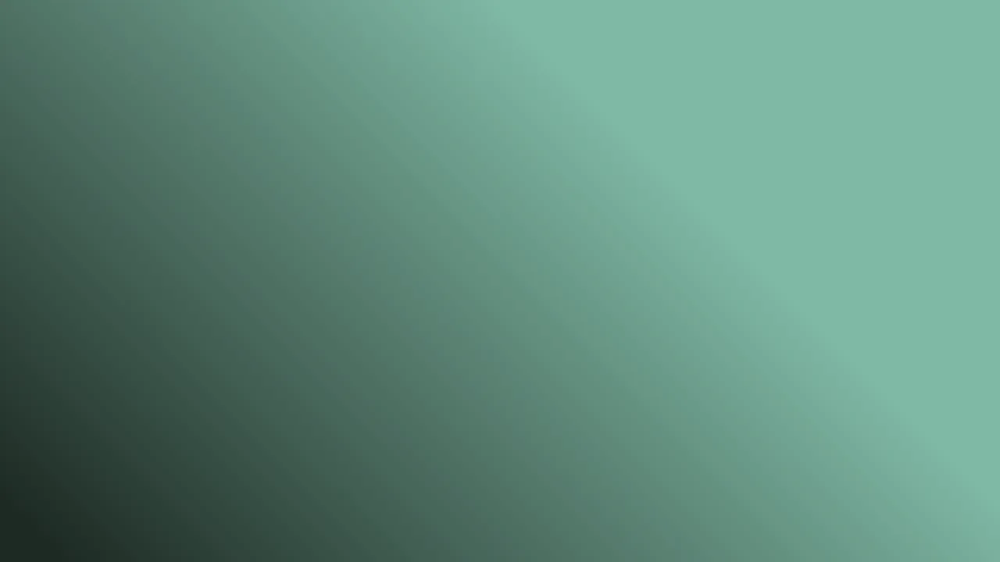

That is `dem-thanh-pho.jpg` (1600×900), stored in the same folder as the post. As the first image, right at the top, it is likely the largest thing on screen when the page appears, so the theme loads it straight away with `loading="eager"` and `fetchpriority="high"`. Every image after it loads lazily, as the reader scrolls near.

Hugo knows the image's size, so the `` carries `width` and `height`: the browser reserves the space and the text does not jump when the image arrives. It also gets a `srcset` of WebP copies 480, 960, 1440 and 1600 pixels wide, and the browser picks the one that fits the screen. Click the image to open the original file.

The same image is set as `cover.image` in the front matter. The theme does not draw a cover above the post; it uses the image for the Open Graph card shown when someone pastes the post's link into a social network or a chat app.

## Images in the bundle

An image next to `index.md` is a page resource, referenced by its file name alone. JPEG, PNG and WebP files get resized copies at build time; SVG and GIF are served as they are.

### A PNG with attributes

{#hoa-van .wide}

`hoa-van.png` (1200×675) gets the same treatment as the JPG: a size and a WebP `srcset`. The `{#hoa-van .wide}` line right below it is a Markdown attribute that puts an `id` and a class on the `` itself. That lets you [link to this exact image](#hoa-van) or style the `wide` class in your own CSS.

### A WebP with a caption

An image that stands alone in its paragraph and has a title becomes a `<figure>` with a `<figcaption>`. The alt text describes what is in the picture for screen reader users, while the caption is a remark everyone sees; the two should complement each other, not repeat each other.

### A GIF served as is

Hugo cannot resize a GIF and keep it moving, so `song.gif` is served exactly as stored, with no `srcset`, `width` or `height`. It still loads lazily like every other image.

## An image inside a link

`la-ban.svg` is a vector image, so it stays as is: it is sharp at any size and needs no resized copies. It already sits inside a link to Wikipedia, so the theme does not wrap it in a second link to the original file — an `<a>` inside an `<a>` is invalid HTML.

## An image from the static folder

This file lives at `static/img/tinh-tu-static.png` and is referenced with the root-relative path `/img/tinh-tu-static.png`. The demo runs under `/nocturne/` on GitHub Pages, so the theme adds the base path and the image loads from `/nocturne/img/tinh-tu-static.png`. Change `baseURL` and the image still shows up, no edits to the post. Files in `static/` are not page resources, so there are no resized copies.

## Images from another host

A full URL starting with `https://` is left untouched. The theme does not download remote images at build time, so it does not know their size.

### A GIF that becomes a video

To handle remote images, a site can add a `layouts/_partials/image/remote.html` partial; the theme calls it for every full URL. The demo's partial knows one case only: a GIF in the `/media/` folder that has an MP4 file of the same name. That image is swapped for a muted, looping `<video>` that loads only when you scroll near it and plays only while it is on screen. The MP4 here weighs about 4 KB against the GIF's 23 KB. With JavaScript turned off, the browser shows the original GIF.

The [theme's customization guide](https://github.com/tiennm99/nocturne/blob/main/docs/customization.md#remote-images) explains how to write this partial.
