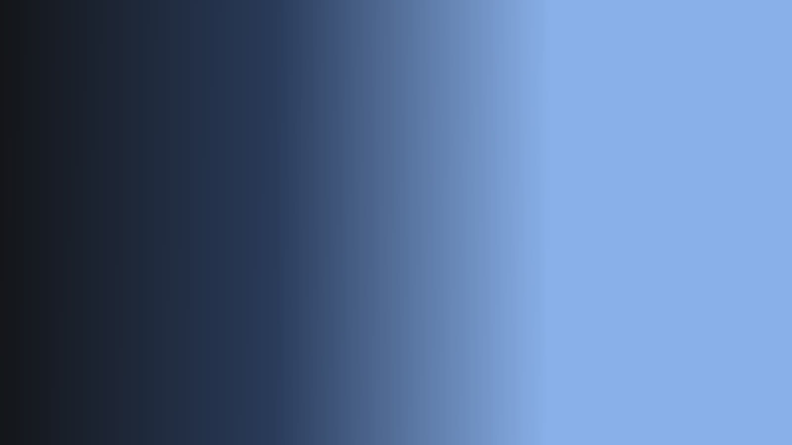
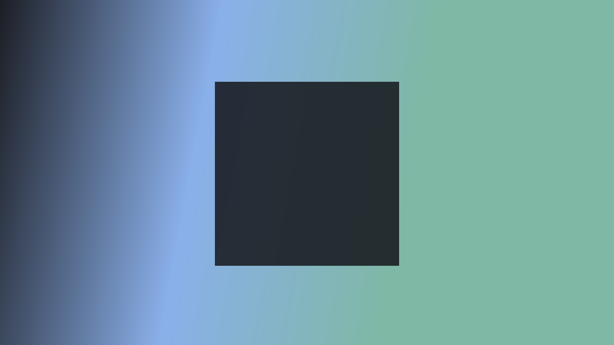
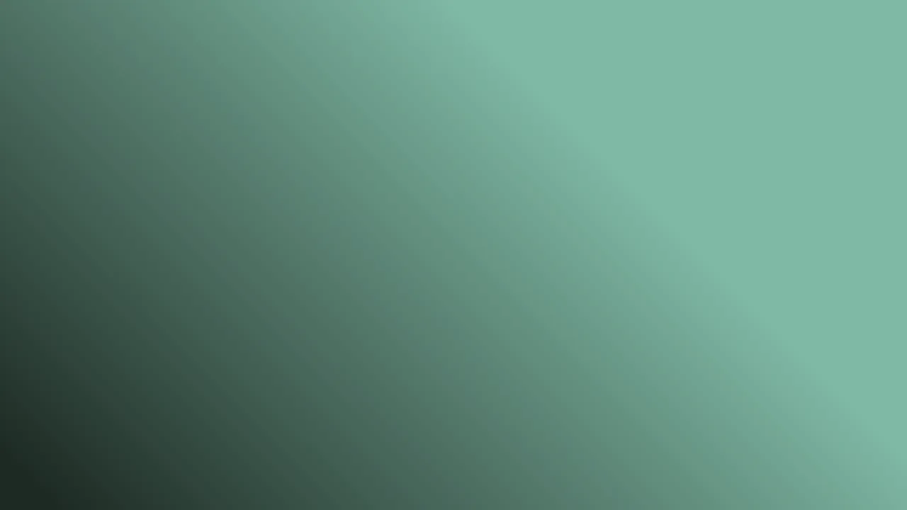
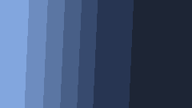

Ảnh trên là `dem-thanh-pho.jpg` (1600×900), nằm cùng thư mục với bài. Vì là ảnh đầu tiên và ở ngay đầu bài, nó nhiều khả năng là phần tử lớn nhất khi trang vừa hiện, nên theme cho tải ngay với `loading="eager"` và `fetchpriority="high"`. Mọi ảnh phía sau đều tải lười, khi người đọc cuộn tới gần.

Hugo đọc được kích thước ảnh, nên thẻ `` có sẵn `width` và `height`: trình duyệt giữ chỗ từ trước và chữ không bị xô khi ảnh tải xong. Kèm theo là `srcset` gồm các bản WebP rộng 480, 960, 1440 và 1600 điểm ảnh, để trình duyệt chọn bản vừa với màn hình. Bấm vào ảnh sẽ mở tệp gốc.

Ảnh này cũng được khai báo ở `cover.image` trong front matter. Theme không vẽ ảnh bìa phía trên bài; nó dùng ảnh ấy cho thẻ chia sẻ Open Graph khi đường dẫn bài được dán lên mạng xã hội hay ứng dụng nhắn tin.

## Ảnh trong bundle

Ảnh đặt cạnh `index.md` là tài nguyên của trang, chỉ cần gọi bằng tên tệp. Với JPEG, PNG và WebP, theme tạo các bản thu nhỏ lúc build; SVG và GIF được giữ nguyên.

### PNG có thuộc tính

{#hoa-van .wide}

`hoa-van.png` (1200×675) được xử lý giống ảnh JPG: có kích thước và `srcset` dạng WebP. Dòng `{#hoa-van .wide}` ngay dưới ảnh là thuộc tính Markdown, gắn `id` và lớp thẳng vào thẻ ``. Nhờ vậy có thể [liên kết tới đúng tấm ảnh](#hoa-van), hoặc viết CSS riêng cho lớp `wide`.

### WebP có chú thích

Ảnh đứng riêng một đoạn và có tiêu đề sẽ thành `<figure>` với `<figcaption>`. Văn bản thay thế (`alt`) mô tả những gì trong ảnh cho người dùng trình đọc màn hình, còn chú thích là lời bình mà ai cũng thấy; hai thứ này nên bổ sung cho nhau, đừng lặp lại nhau.

### GIF giữ nguyên

Hugo không thể thu nhỏ GIF mà vẫn giữ chuyển động, nên `song.gif` được phục vụ đúng như tệp gốc, không `srcset`, không `width` và `height`. Ảnh động vẫn tải lười như mọi ảnh khác.

## Ảnh nằm trong liên kết

`la-ban.svg` là ảnh vector nên được giữ nguyên: nó sắc nét ở mọi cỡ và không cần bản thu nhỏ nào. Ảnh nằm sẵn trong một liên kết tới Wikipedia, nên theme không bọc thêm liên kết tới tệp gốc — thẻ `<a>` lồng trong thẻ `<a>` là HTML sai.

## Ảnh trong thư mục static

Tệp này nằm ở `static/img/tinh-tu-static.png` và được gọi bằng đường dẫn tuyệt đối `/img/tinh-tu-static.png`. Trang demo chạy dưới `/nocturne/` trên GitHub Pages, nên theme tự thêm phần đường dẫn gốc thành `/nocturne/img/tinh-tu-static.png`. Đổi `baseURL` thì ảnh vẫn hiện, không phải sửa bài. Tệp trong `static/` không phải tài nguyên của trang, nên không có bản thu nhỏ.

## Ảnh từ trang khác

Một URL đầy đủ, bắt đầu bằng `https://`, được giữ nguyên. Theme không tải ảnh từ xa về lúc build, nên không biết kích thước của nó.

### GIF thành video

Muốn xử lý ảnh từ xa, site có thể thêm partial `layouts/_partials/image/remote.html`; theme gọi nó cho mọi URL đầy đủ. Partial của trang demo chỉ nhận ra một trường hợp: GIF trong thư mục `/media/` có một tệp MP4 cùng tên. Khi đó ảnh được thay bằng thẻ `<video>` tắt tiếng, phát lặp, chỉ tải khi cuộn tới gần và chỉ chạy khi đang nằm trong màn hình. Tệp MP4 ở đây nặng khoảng 4 KB, so với 23 KB của tệp GIF. Trình duyệt tắt JavaScript vẫn thấy ảnh GIF gốc.

Cách viết partial này có trong [tài liệu tùy biến của theme](https://github.com/tiennm99/nocturne/blob/main/docs/customization.md#remote-images).
